# Neev Sanctuary — Master Privacy & Data Service Inventory
## Complete Evidence-Backed Service Audit, Google OAuth Scopes & Data Lifecycle Map

**Application Identity:** Neev Sanctuary  
**Canonical Public Website:** `https://neevsanctuary.devamit.co.in/`  
**Primary Domain:** `devamit.co.in` (Amit Dev Labs)  
**Google Cloud Project:** `gen-lang-client-0587640262`  
**Author & Data Protection Officer:** Amit Chakraborty (`amit@devamit.co.in`)  
**Jurisdiction:** India (DPDP Act 2023) & Global (GDPR / CCPA)  
**Effective Date:** October 20, 2026 · **Last Verified:** October 22, 2026  

---

## 1. Audit Methodology & Evidence Classifications

Every service, API, and data flow documented in this inventory has been audited directly against the active codebase across `Apps/neev-site`, `Apps/neev` (mobile), and `Apps/neev-v2` (web), cross-referenced with Google Cloud Console project `gen-lang-client-0587640262`.

Evidence statuses used throughout this document:
- **Confirmed Active:** Production-relevant implementation and execution paths are verified.
- **Implemented, Deployment Unverified:** Code exists in repository, but live production trigger is subject to user opt-in.
- **Configured Only:** Google Cloud API enabled or credentials configured, but not called in default customer flows.
- **Development/Test Only:** Used exclusively for developer tooling, local builds, or CI/CD pipelines.
- **Planned / Future:** Architecturally specified for roadmap, but no active production scope requested.
- **Confirmed Unused / Obsolete:** Enabled in GCP default templates, but no integration code in repository.

---

## 2. Complete Discovered Services & API Register (All 51 GCP Services)

Below is the authoritative register of all 51 APIs observed in Google Cloud project `gen-lang-client-0587640262`, detailing their role, environment, and user data handling:

| # | Service Name & API Identifier | Status | Environment | Purpose in Neev Sanctuary | Processes User Data? | Disclosed in Privacy Policy? |
|---|---|---|---|---|---|---|
| 1 | **Google Calendar API** (`calendar-json.googleapis.com`) | Confirmed Active (User Opt-in) | Production / Mobile / Web | Syncs family ritual dates (Diwali, Chhath), pediatric vaccination schedules, and doctor visits to personal Google Calendar. | Yes (User-selected calendar events) | Yes (Section 3) |
| 2 | **Google Tasks API** (`tasks.googleapis.com`) | Confirmed Active (User Opt-in) | Production / Mobile / Web | Syncs household chores, medicine schedules, and grocery lists to a dedicated "Neev Sanctuary" task list. | Yes (Family chores & reminders) | Yes (Section 3) |
| 3 | **Google Drive API** (`drive.googleapis.com`) | Implemented (Optional) | Production / Mobile | Allows families to backup encrypted vault files (oral folklore, heirloom recipes, identity cards) to their private Google Drive. Restricted to `drive.file`. | Yes (Files created by Neev only) | Yes (Section 3) |
| 4 | **Google Docs API** (`docs.googleapis.com`) | Implemented (Optional) | Production / Web | Exports family oral histories and recipe collections into formatted Google Docs. | Yes (Export-only document content) | Yes (Section 3) |
| 5 | **People API** (`people.googleapis.com`) | Confirmed Active (Optional) | Production / Mobile | Powers contact picker during family invitation flows (`contacts.readonly`) to invite grandparents or emergency guardians without manual typing. | Yes (Selected contact names/emails) | Yes (Section 3) |
| 6 | **Gmail API** (`gmail.googleapis.com`) | Configured Only | Infrastructure | Configured in GCP project; reserved for system notification delivery. Not used for reading personal inbox emails. | No (No inbox reading) | Yes (Disclosed as non-reading) |
| 7 | **Google Sheets API** (`sheets.googleapis.com`) | Implemented (Optional) | Production / Web | Exports family monthly grocery and utility budgets into private Google Sheets. | Yes (Export-only budget data) | Yes (Section 3) |
| 8 | **Google Meet API** (`meet.googleapis.com`) | Implemented (Optional) | Production / Web / Mobile | Generates secure Google Meet conference links for scheduled multi-household Sunday family calls and remote puja check-ins. | Ephemeral meeting URL generation only; no call recording. | Yes (Section 3) |
| 9 | **Google Sign-In / OAuth 2.0** (`openid, profile, email`) | Confirmed Active | Production / All Clients | Core authentication and identity verification. Links user to their family sanctuary. | Yes (Name, email, avatar, Google UID) | Yes (Section 3) |
| 10 | **Token Service API** (`securetoken.googleapis.com` / `sts.googleapis.com`) | Confirmed Active | Infrastructure | Handles backend credential exchange, validating Google ID tokens and issuing short-lived OAuth 2.0 access tokens. | Ephemeral cryptographic tokens only | Yes (Section 4) |
| 11 | **Firebase Installations API** (`firebaseinstallations.googleapis.com`) | Confirmed Active | Client Mobile SDK | Generates unique anonymous app-instance identifiers for push notification routing (FCM) and SDK telemetry. | Anonymous device instance ID; not correlated with advertising. | Yes (Section 4) |
| 12 | **Gemini API** (`generativelanguage.googleapis.com`) | Confirmed Active (Sanitized) | Production Backend | Powers cultural summaries (panchang explanations, folklore bedtime stories). Family health notes and children PII are sanitized at the request boundary. | No raw PII or Google data sent. Zero model training. | Yes (Section 4 & 5) |
| 13 | **Cloud Firestore API** (`firestore.googleapis.com`) | Confirmed Active | Production Backend | Real-time document database syncing shared chore checklists and family calendar events across active household devices. | Encrypted family records governed by security rules. | Yes (Section 4) |
| 14 | **Identity Toolkit API** (`identitytoolkit.googleapis.com`) | Confirmed Active | Production Auth | Validates credentials, processes OAuth callbacks, and manages session lifecycle for Firebase Authentication. | User UID, email, auth timestamps. | Yes (Section 4) |
| 15 | **Gemini for Google Cloud API** (`cloudaicompanion.googleapis.com`) | Development Only | Developer Workstation | Cloud AI companion used by development IDEs (Antigravity / Cloud Code) during software engineering. | Zero customer data processed. Developer workstation only. | Yes (Section 4) |
| 16 | **Cloud Storage / Storage API** (`storage.googleapis.com`) | Confirmed Active | Infrastructure | Stores static web assets, application binaries, and encrypted user vault backups. | Encrypted media and static assets. | Yes (Section 8) |
| 17 | **Cloud Logging API** (`logging.googleapis.com`) | Confirmed Active | Infrastructure | Captures server request latency, HTTP status codes, and operational error traces. Scrubbed of auth tokens and Google response bodies. | Anonymized operational logs. | Yes (Section 4) |
| 18 | **Cloud Monitoring API** (`monitoring.googleapis.com`) | Confirmed Active | Infrastructure | Server health, CPU/memory utilization, and uptime alerting. | None (System metrics only). | Internal Only |
| 19 | **Cloud Pub/Sub API** (`pubsub.googleapis.com`) | Configured Only | Backend Worker | Message bus for asynchronous background processing (e.g., scheduled notification triggers). | Ephemeral event messages. | Internal Only |
| 20 | **Firebase Cloud Messaging (FCM)** (`fcm.googleapis.com` / `fcmregistrations.googleapis.com`) | Confirmed Active | Production Mobile | Dispatches push notifications for medicine reminders, milestone alerts, and family chat pings. | Push device tokens & encrypted notification payloads. | Yes (Section 4) |
| 21 | **Firebase Remote Config API** (`firebaseremoteconfig.googleapis.com`) | Implemented | Client Mobile SDK | Dynamically manages feature flags, seasonal panchang themes, and app configuration defaults. | None (Global non-personalized feature flags). | Internal Only |
| 22 | **Firebase Rules API** (`firebaserules.googleapis.com`) | Confirmed Active | Infrastructure | Deploys and manages declarative security rules for Cloud Firestore and Storage. | None (Access control definitions). | Internal Only |
| 23 | **Firebase App Distribution / Testers** (`firebaseappdistribution.googleapis.com`) | Development/Test Only | Staging | Internal beta distribution of Android APKs to verified family test rings. | Developer/tester email addresses. | Internal Only |
| 24 | **Firebase Hosting API** (`firebasehosting.googleapis.com`) | Configured Only | Hosting | Auxiliary hosting endpoint (`gen-lang-client-0587640262.firebaseapp.com`) used as Firebase Auth redirect handler. | Ephemeral auth redirect tokens. | Yes (Section 8) |
| 25 | **Maps SDK for Android** (`maps-android-backend.googleapis.com`) | Confirmed Unused / Fallback | Mobile Client | Enabled as an optional fallback; active product utilizes 100% free OpenStreetMap & Carto vector tiles to avoid billable telemetry. | None (Not actively called in default flow). | Yes (Section 6) |
| 26–51 | **Default GCP Administrative APIs** (BigQuery, BigQuery Storage, Cloud SQL, App Engine Admin, Dataplex, Cloud Trace, Dataform, Cloud Testing, Service Usage, etc.) | Confirmed Unused / Template Defaults | Cloud Platform Admin | Default administrative APIs provisioned during GCP project initialization. No Neev application code invokes these services. | Zero customer data processed. | Yes (Section 4) |

---

## 3. Google OAuth Scope Matrix & Justifications

Neev Sanctuary requests the minimum necessary scopes to support explicit, user-initiated family coordination features. Connecting Google is strictly optional:

```
+-------------------------------------------------------+-----------------------------+------------------------------------+--------------------------+
| Scope URI                                             | Google API                  | Purpose & Feature Justification    | Verification Category    |
+-------------------------------------------------------+-----------------------------+------------------------------------+--------------------------+
| https://www.googleapis.com/auth/calendar.events       | Google Calendar API         | Bi-directional event export for    | Sensitive Scope          |
|                                                       |                             | family festivals, exams, doctor    |                          |
|                                                       |                             | visits, and shared parenting.      |                          |
+-------------------------------------------------------+-----------------------------+------------------------------------+--------------------------+
| https://www.googleapis.com/auth/tasks                 | Google Tasks API            | Syncs household chores, grocery    | Sensitive Scope          |
|                                                       |                             | lists, and medicine administration |                          |
|                                                       |                             | reminders to dedicated task lists. |                          |
+-------------------------------------------------------+-----------------------------+------------------------------------+--------------------------+
| https://www.googleapis.com/auth/drive.file            | Google Drive API            | Allows user to export encrypted    | Non-Sensitive Scope      |
|                                                       |                             | family document backups to their   | (Restricted to app files)|
|                                                       |                             | personal Drive. Restricted to app. |                          |
+-------------------------------------------------------+-----------------------------+------------------------------------+--------------------------+
| https://www.googleapis.com/auth/contacts.readonly     | People API                  | Native family circle picker during | Sensitive Scope          |
|                                                       |                             | invitation flow. Ephemeral read.   |                          |
+-------------------------------------------------------+-----------------------------+------------------------------------+--------------------------+
| openid, profile, email                                | Identity / Google Sign-In   | Account authentication, avatar,    | Non-Sensitive Scope      |
|                                                       |                             | display name, and safety notices.  |                          |
+-------------------------------------------------------+-----------------------------+------------------------------------+--------------------------+
```

### Least Privilege Enforcement
1. **Calendar:** We request `calendar.events` rather than full `calendar` (which grants calendar deletion/creation rights). Operations are scoped to events tagged with the Neev family identifier.
2. **Tasks:** We request `tasks` strictly for managing the specific "Neev Sanctuary" task list.
3. **Drive:** We use `drive.file` instead of broad `drive` or `drive.readonly`. The app can only see and manage files that it specifically created.
4. **Contacts:** Read-only access (`contacts.readonly`) invoked solely when the user clicks "Invite Family Member". Contacts are not ingested into cloud CRM databases.

---

## 4. End-to-End Data Flow Architecture

```mermaid
graph TD
    User["👤 Family Member (Grandparent / Parent / Child)"]
    
    subgraph ClientLayer["📱 Neev Sanctuary Client (iOS / Android / Web)"]
        UI["React Native / Next.js UI"]
        MMKV["Local-First MMKV Storage (AES-256-GCM)"]
        Keystore["Hardware Key (Apple Secure Enclave / Android Keystore)"]
        Sanitizer["Data Minimization & Context Sanitizer Boundary"]
    end

    subgraph EdgeLayer["🌐 Cloudflare Anycast Edge"]
        EdgeDNS["DNS & DDoS Shield (devamit.co.in)"]
        EdgeWorker["Static Web Assets (neevsanctuary.devamit.co.in)"]
    end

    subgraph GoogleWorkspace["🏢 Google Workspace APIs (User-Authorized)"]
        GCal["Google Calendar API (calendar.events)"]
        GTasks["Google Tasks API (tasks)"]
        GDrive["Google Drive API (drive.file)"]
        GPeople["People API (contacts.readonly)"]
    end

    subgraph GCPInfrastructure["☁️ Google Cloud & Firebase (gen-lang-client-0587640262)"]
        FirebaseAuth["Identity Toolkit & Token Service (sts.googleapis.com)"]
        Firestore["Cloud Firestore (Realtime Chore Sync)"]
        GeminiAPI["Gemini API (Sanitized Cultural Summaries Only)"]
        FCM["Firebase Cloud Messaging (Medicine Bells & Alerts)"]
    end

    subgraph SupabaseCloud["🛡️ Supabase Infrastructure (kwrdugillyakxgvgbrsu)"]
        Postgres["PostgreSQL Database (Row-Level Security)"]
        FamilyRelay["Family Membership & Encrypted Backup Relay"]
    end

    User -->|1. Direct Input / Tap| UI
    UI <-->|2. Hardware Encrypted Local Read/Write| MMKV
    MMKV --- Keystore
    
    UI -->|3. Optional OAuth Consent| FirebaseAuth
    UI -->|4. Optional Calendar/Task Sync| GCal
    UI -->|4. Optional Chore Sync| GTasks
    UI -->|4. Optional Vault Backup| GDrive
    UI -->|4. Optional Relative Invite| GPeople
    
    UI -->|5. Sanitized Cultural Queries| Sanitizer
    Sanitizer -->|Strict Filter: No Health, No Kids PII| GeminiAPI
    
    UI <-->|6. Real-Time Chores & Rituals| Firestore
    UI <-->|7. Family Circle Relays & Membership| Postgres
    
    FirebaseAuth -.->|Token Verification| UI
    FCM -.->|Push Notifications| UI
    EdgeWorker -.->|Fast Static Delivery| User
```



---

## 5. Gemini AI Sensitive Data Minimization Assessment

1. **Request-Boundary Sanitization:** All prompts sent to `generativelanguage.googleapis.com` are filtered at the application boundary. Family health notes, medication logs, real names of minor children, and Google Workspace calendar/task content are strictly excluded.
2. **Feature Confinement:** Gemini is used solely for non-sensitive, cultural enrichment tasks:
   - Explaining traditional Indian festival tithis and rituals.
   - Formatting grandparent audio stories into illustrated bedtime tales.
   - Suggesting balanced joint-family weekly meal plans based on regional cuisines.
3. **No Training on Prompts:** Prompts submitted via the Gemini API are not used to train or refine Google models under current enterprise API terms.
4. **No Human Review:** Internal logs do not store raw prompts, ensuring zero exposure to human evaluators.

---

## 6. Verified Security Controls & Limitations

1. **At-Rest Encryption:** Local client databases on mobile use MMKV encrypted with AES-256-GCM. Cryptographic keys are protected by the hardware-backed iOS Secure Enclave or Android Keystore.
2. **In-Transit Encryption:** All communications use TLS 1.3 with strict modern cipher suites.
3. **Supabase Row-Level Security (RLS):** All remote database queries require authenticated JWTs with family sanctuary ID matching. Cross-family data access is technically prohibited at the database engine level.
4. **Factual Limitations (Anti-Exaggeration Audit):**
   - We do *not* claim "100% universal hardware zero-knowledge" for shared features: Cloud Firestore and Supabase relay shared chore and calendar metadata across devices in the same family circle.
   - We do *not* claim that Google approval has been completed: verification is factual and in-progress.

---

## 7. Data Retention, Revocation & Hard Deletion

1. **In-App Hard Deletion:** Users can navigate to `Settings > Sanctuary Profile > Delete Family Sanctuary`. This executes an immediate, cascading purge of:
   - Local MMKV records and hardware encryption keys.
   - Firestore family chore documents and membership records.
   - Supabase user profile and circle mappings.
2. **Google Access Revocation:** Users can revoke OAuth grants instantly at `https://myaccount.google.com/permissions`. Upon revocation, short-lived access tokens expire within 60 minutes and refresh tokens are permanently invalidated.
3. **Email Hard Purge:** Users can email `amit@devamit.co.in` for complete infrastructure deletion within 24 hours.
4. **Backup Expiration:** Temporary database backup snapshots roll off on a 30-day rolling lifecycle.

---

## 8. Summary of Public Site Corrections Applied

1. **Canonical Privacy Route:** Unified all references to `https://neevsanctuary.devamit.co.in/privacy`. Route `/privacy-policy` automatically redirects with a permanent canonical link.
2. **Homepage Reviewability:** Removed all authentication modals, popups, and gates from `https://neevsanctuary.devamit.co.in/`. Added an unauthenticated Google Workspace trust card explaining Calendar & Tasks sync on the initial viewport.
3. **Badge Accuracy:** Removed premature "Google Verified" badges; replaced with factual "Google Limited Use" and "Google Workspace Integration".
4. **SEO & GEO:** Implemented Bangalore geo-coordinates (`12.9716;77.5946`, `IN-KA`), JSON-LD schemas (`WebSite`, `SoftwareApplication`, `FAQPage`), and machine-readable context at `/llms.txt` and `/agents.txt`.
